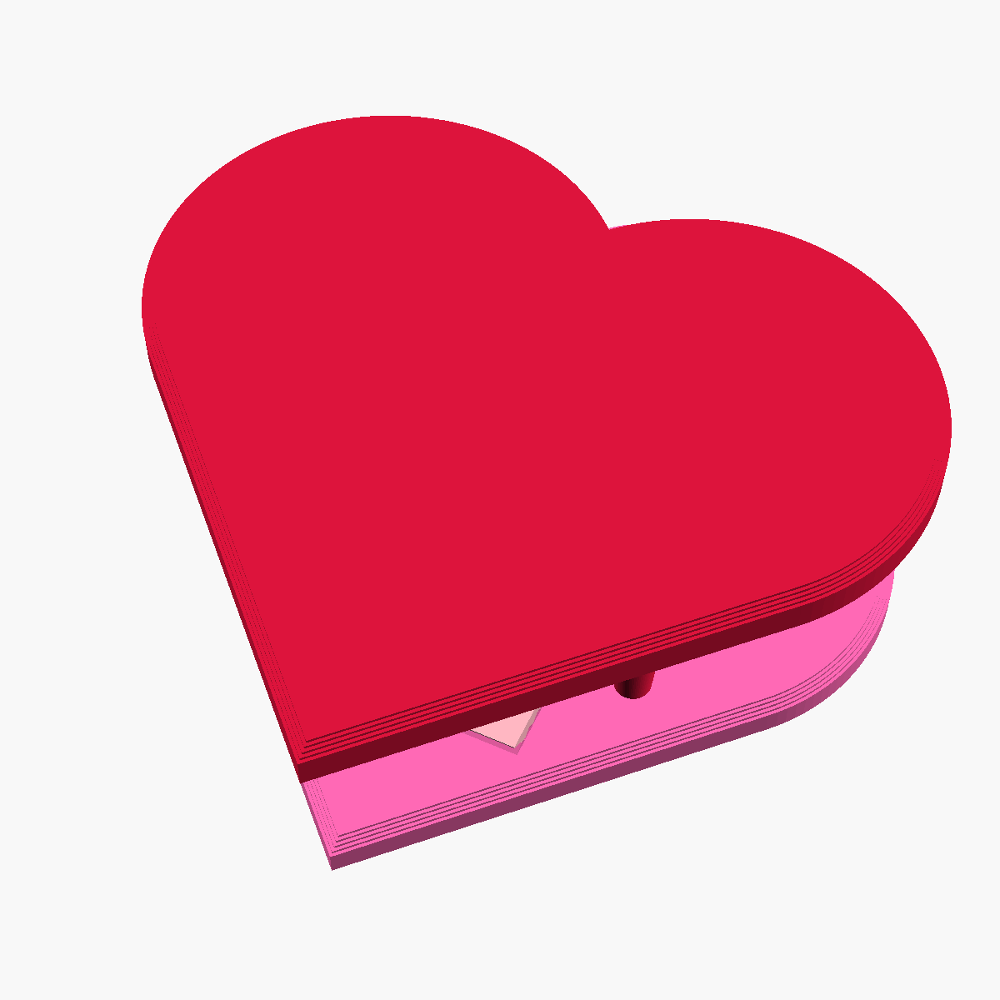

# Heart suspender clip (heart pacifier-clip style, hinge hidden)

From the front it's just a heart with a keychain ring at the top. The hinge, jaw and teeth all sit behind the heart.
Hang it from your bag by the ring. The jaw mouth opens downward between the front heart and the heart-shaped back plate, and the flowstar clips in there and hangs below.

  

## How it works
- **Body:** a heart-shaped back plate with teeth, two pairs of hinge knuckles and the keychain ring.
- **Front jaw:** pivots on pin B. Below the pin it's the gripping blade; above the pin it has a short tail.
- **Front heart:** the locking lever, on pin A behind the jaw's tail. Its cam pushes the tail forward, which swings the blade back onto the teeth.
  Lift the heart's point out and up to release the jaw, push the flowstar's edge up into the mouth, then fold the heart flat.
  The cam rolls 8° past dead-center and locks. Two small stops behind the heart rest it flat.

## Thickness: four swappable front jaws
| Front jaw | Grips | Mouth opens to |
|---|---|---|
| `jaw_size0.stl` | 0 – 1 mm (fabric, straps) | 2.2 mm |
| `jaw_size1.stl` | 1 – 2 mm | 3.1 mm |
| `jaw_size2.stl` | 2 – 3 mm | 4.1 mm |
| `jaw_size3.stl` | 3 – 4 mm | 5.1 mm |

Each blade bends a little, like the steel plate in a metal clip, so the heart always closes flat. To swap a jaw, push out pin B (the lower pin).

## Parts (`stl/`)
| File | Print orientation |
|---|---|
| `heart_clip_all_parts.stl` | everything laid out (body, heart, 4 jaws, 2 pins) |
| `body.stl` | back flat on bed |
| `heart.stl` | front face down |
| `jaw_size0-3.stl` | standing on edge (as exported) |
| `pin_x2.stl` | lying flat, print 2. A 3 mm steel rod also works |

No supports are needed. PETG is recommended for the jaws because the blade has to spring; PLA works for light use. Use 0.2 mm layers, 4 walls and 40%+ infill.
The clip is 52 mm wide, about 64 mm tall with the ring, and about 18 mm thick.

## Assembly
1. Put the jaw between the lower knuckles with the blade pointing down, then push a pin through (pin B).
2. Put the heart's hinge between the upper knuckles, behind the jaw's tail, then push a pin through (pin A).
3. Add a drop of CA glue on pin A's ends. Leave pin B unglued if you want to swap jaws.

## Customising (`heart_suspender_clip.scad`)
`PART` = `assembly` | `open` | `body` | `jaw` | `heart` | `pin` | `plate`, and `JAW_SIZE` = 0–3.
Useful parameters are `heart_w`, `ring_hole`, `size_step`, `blade_t` (grip stiffness) and the pin clearances.
