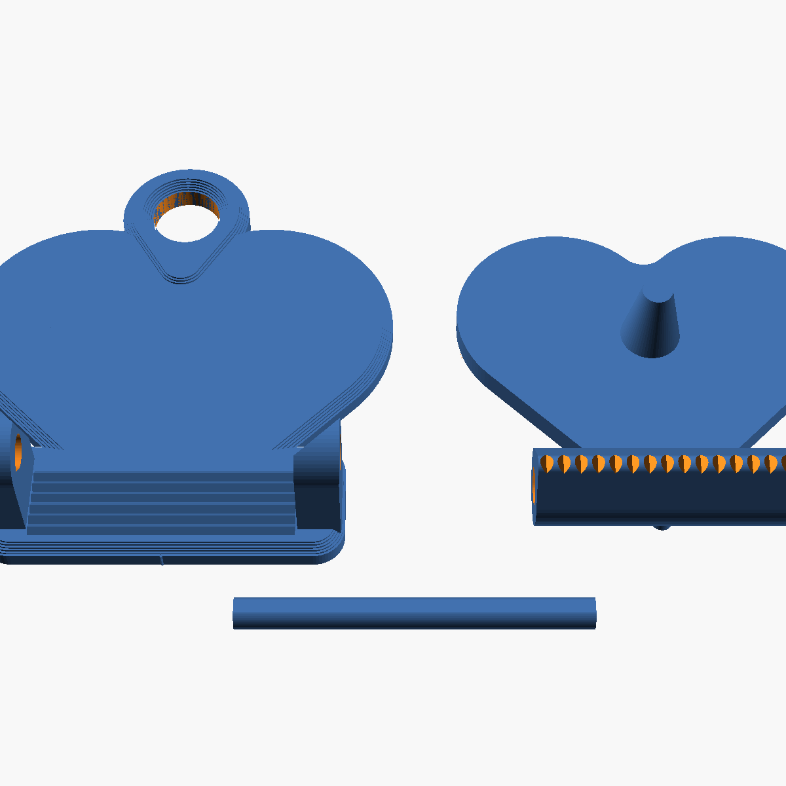

# Heart suspender clip (lever / locking-tab style)

A heart-shaped clip in the classic suspender style, with a flip-up locking tab instead of a screw.
Hang it from your keys or a hook by the ring at the top of the heart. The jaw is in a small hinge bar under the heart's point and grips the star below, so the heart hangs right-side up.

 

## Parts (`stl/`)
| File | Print orientation | Notes |
|---|---|---|
| `body.stl`  | back flat on bed | heart plate, keychain ring (top), hinge bar + teeth (bottom) |
| `lever.stl` | front face down  | the front heart (locking tab) with toothed over-center cam |
| `pin.stl`   | lying flat       | 3 mm hinge pin. A 3 mm steel rod or a cut nail also works |
| `heart_clip_all_parts.stl` | as laid out | all three parts on one plate |

No supports are needed: the horizontal holes are teardrop-shaped. Use PETG or PLA, 0.2 mm layers, at least 4 walls, and 40%+ infill so the cam and cheeks are solid.

## Assembly
1. Set the lever between the cheeks, with the heart over the body.
2. Push the pin through cheek, lever, then the other cheek. Add a drop of CA glue at each end, or melt the ends slightly.

## Use
Put a split ring or lobster clasp through the ring at the top. Flip the front heart out to open a ~3 mm gap in the bottom bar, push the star's edge up into it, then press the heart back down.
The cam rolls 10° past dead-center onto the teeth and locks. The star's weight pulls it tighter, not open.

## Customising (`heart_suspender_clip.scad`)
Set `PART` to `assembly`, `open`, `body`, `lever`, `pin` or `plate`. Useful parameters:
- `heart_w`: overall size (default 44 mm)
- `ring_hole`: keychain ring hole (default 7 mm)
- `grip_gap`: lower this for thin fabric, raise it for thick fabric
- `pin_clr_lever` / `pin_clr_body`: hinge fit for your printer
- `overcenter`: increase for a harder snap
