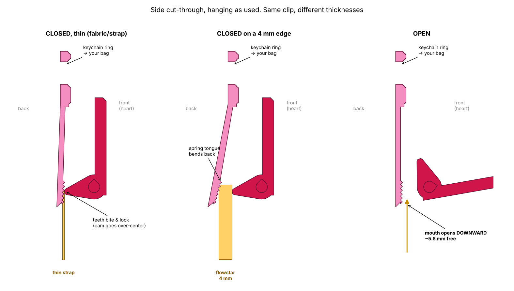

# Heart suspender clip (lever / locking-tab style)

A heart-shaped clip in the classic suspender style, with a flip-up locking tab instead of a screw.
Hang it from your bag by the keychain ring at the top. The jaw at the bottom grips your flowstar, which hangs below.

 

## Fits many thicknesses (0 to about 5 mm)
This works the way a metal suspender clip does: the lever cam pushes against a spring.
The jaw's back face is a **spring tongue** cut into the back plate. When you snap the heart shut, the cam always closes to the same locked position, and the tongue bends back by however much the flowstar's edge needs.

| Edge thickness | Tongue bends back | Clamp force (PLA) |
|---|---|---|
| 0 (fabric) | 0.9 mm | ~2.6 N |
| 2 mm | 2.9 mm | ~9 N |
| 4 mm | 4.9 mm | ~15 N |
| 5 mm | 5.9 mm | ~18 N |

The jaw opens 5.6 mm with nothing in it. The cam locks 11° past center, so the flowstar's weight pulls it tighter, not open.

## Parts (`stl/`)
| File | Print orientation | Notes |
|---|---|---|
| `heart_clip_all_parts.stl` | as laid out | all three parts on one plate |
| `body.stl`  | back flat on bed | heart, keychain ring, hinge bar, spring tongue with teeth |
| `lever.stl` | front face down  | the front heart (locking tab) with toothed over-center cam |
| `pin.stl`   | lying flat       | 3 mm hinge pin. A 3 mm steel rod or a cut nail also works |

No supports are needed. **PETG is recommended** because it springs back best. PLA works too, but if you'll often clip things over ~4 mm thick, use PETG. Use 0.2 mm layers, 4 walls and 40%+ infill.

## Assembly
1. Set the front heart between the two hinge blocks.
2. Push the pin through block, cam and block. Add a drop of CA glue at each end.

## Use
1. Put the keychain ring on your bag.
2. Flip the heart out at the top to open the mouth at the bottom.
3. Push the flowstar's edge up into the jaw.
4. Press the heart flat until it snaps.

## Customising (`heart_suspender_clip.scad`)
Set `PART` to `assembly`, `open`, `body`, `lever`, `pin` or `plate`. Useful parameters:
- `heart_w`: overall size (default 44 mm)
- `ring_hole`: keychain ring hole (default 7 mm)
- `tongue_t`: spring stiffness. Use 1.7 for a stronger grip, 1.3 for softer
- `preload`: grip on very thin things
- `open_gap`: how wide the jaw opens
- `pin_clr_lever` / `pin_clr_body`: hinge fit for your printer
