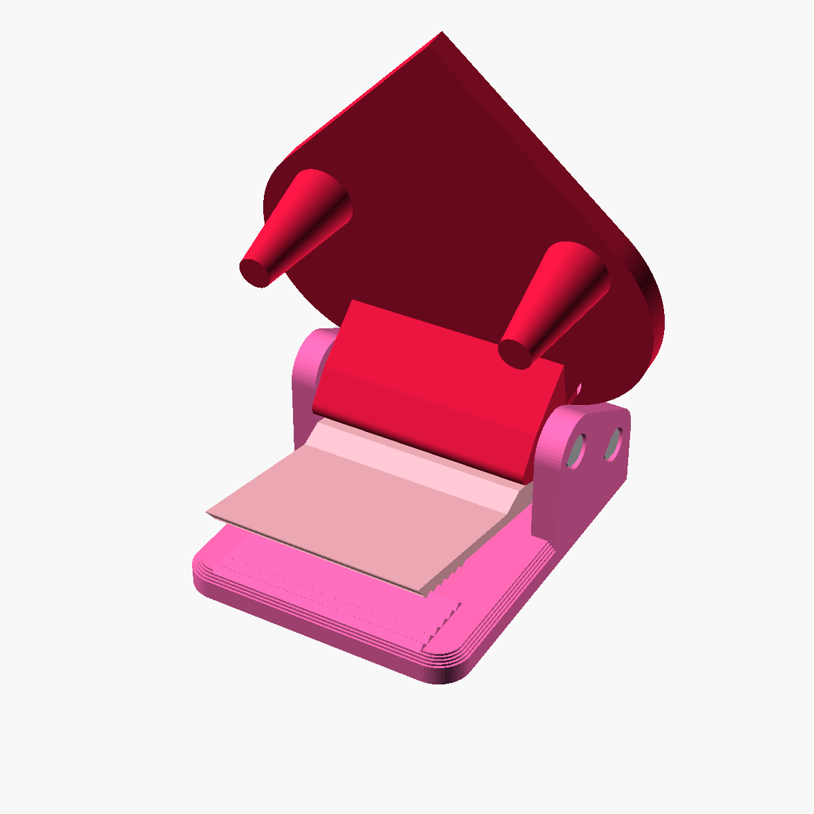

# Heart suspender clip (heart pacifier-clip style)

Modelled on the classic metal heart suspender / pacifier clip. A small jaw block has a keychain ring on top, and the heart hangs below it as the locking lever.
Hang it from your bag by the ring. The jaw mouth opens downward behind the heart, and the flowstar clips in there and hangs below.

 

## How it works
- **Body:** a jaw block with teeth, two hinge knuckles and the keychain ring.
- **Front jaw:** a plate on the top pin that swings open at the bottom.
- **Heart:** the locking lever, on the second pin. The cam on its hinge presses the front jaw shut.
  Lift the heart up and over to release the jaw, push the flowstar's edge up into the mouth, then fold the heart back down.
  The cam rolls 8° past dead-center and locks. Two small stops on the back of the heart rest it flat.

## Thickness: three swappable front jaws
| Front jaw | Grips | Mouth opens to |
|---|---|---|
| `jaw_size0.stl` | 0 – 1.4 mm (fabric, straps) | 3.5 mm |
| `jaw_size1.stl` | 1.4 – 2.8 mm | 4.8 mm |
| `jaw_size2.stl` | 2.8 – 4.2 mm | 4.7 mm |

Each jaw's lower blade bends up to ~1.4 mm, like the steel plate in a metal clip, so the heart always snaps fully flat. To swap a jaw, push out the top pin.

## Parts (`stl/`)
| File | Print orientation |
|---|---|
| `heart_clip_all_parts.stl` | everything laid out (body, heart, 3 jaws, 2 pins) |
| `body.stl` | back flat on bed |
| `heart.stl` | front face down |
| `jaw_size0/1/2.stl` | standing on edge (as exported) |
| `pin_x2.stl` | lying flat, print 2. A 3 mm steel rod also works |

No supports are needed. PETG is best for the jaw blade; PLA works. Use 0.2 mm layers, 4 walls and 40%+ infill.

## Assembly
1. Put the front jaw between the knuckles, then push a pin through the **top** holes.
2. Put the heart's hinge between the knuckles, then push a pin through the **lower** holes.
3. Add a drop of CA glue on the pin ends that sit in the knuckles. Leave them unglued if you want to swap jaws later.

## Customising (`heart_suspender_clip.scad`)
`PART` = `assembly` | `open` | `body` | `jaw` | `heart` | `pin` | `plate`, and `JAW_SIZE` = 0/1/2.
Useful parameters are `heart_w`, `ring_hole`, `size_step`, `preload` (grip strength), `blade_t` (blade stiffness) and the pin clearances.
