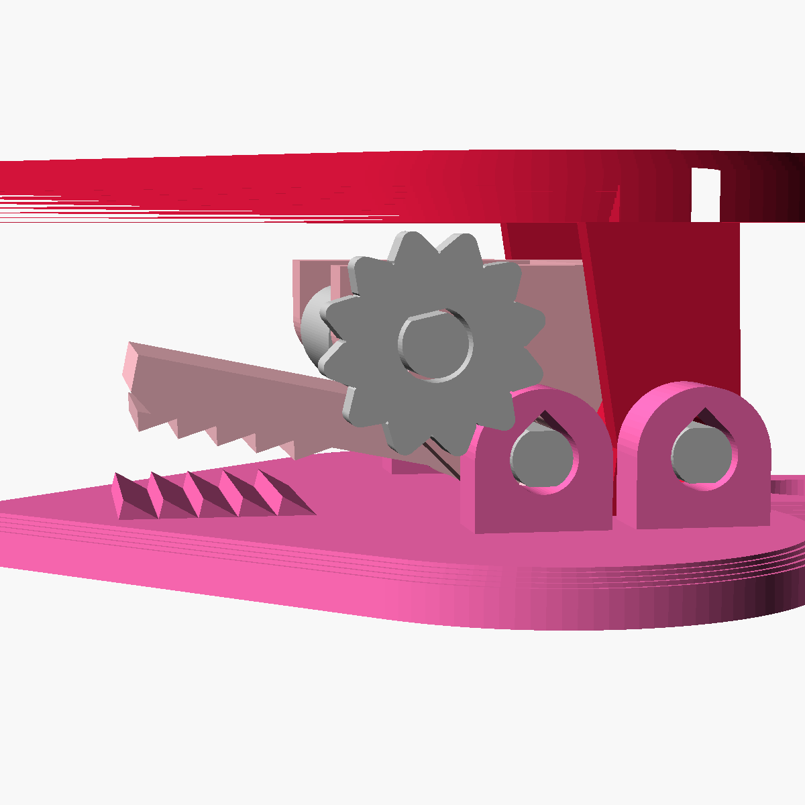

# Heart clip

A heart-shaped, suspender-style locking clip for hanging a flowstar from a bag. From the front it's just a heart with a keychain ring. The hinge, jaw and grip wheel are hidden behind it.

  

## Using it
Made to work with long nails, shaky hands, or after a few drinks: big simple motions, nothing fiddly.

1. **Hang it:** put a keychain ring or lobster clasp through the ring at the top and onto your bag.
2. **Open:**
   - **Easiest:** hook a fingertip or nail under the bottom edge of the heart and lift. The back of the edge is bevelled so it catches easily.
   - **Or:** press the top of the heart backward firmly with your thumb. It pivots like a seesaw.
3. **Insert:** hold the heart up with one hand and push the flowstar's canvas trim up into the gap between the two hearts with the other. It slides in over the teeth. The heart falls closed on its own if you let go, so keep a thumb on it.
4. **Close:** press the middle of the heart until it clicks flat. Until it clicks, the trim pushes it back open, so you can see when it isn't locked.

### Set the grip once for your trim
The toothed wheel at the **right-hand edge**, between the two hearts, sets how tight the jaw closes.
- **Flick a tooth:** each tooth is about 0.5 mm. Rolling the wheel's front edge **up tightens**; **down loosens**.
- **Easiest with the heart open:** the wheel turns freely then.
- **Check it:**
  1. Close the clip on the trim and give it a firm tug.
  2. If it slips, open the heart, flick one tooth tighter and try again.
  3. If the heart is hard to click shut, flick one tooth looser.
- **Leave it:** once it's right, leave the wheel alone. Daily use is just open, insert, close.
- **Range:** about **0.3–5 mm** of trim, from single canvas to folded in half. Past either end it wraps round to the other end, so if one flick suddenly makes it much tighter or looser, flick back.

 

## How it works
- **Jaw arm:** pivots on the lower pin. The heart's cam pushes its top bar.
- **Blade:** the gripping jaw, with one-way barbed teeth. It hangs on the same pin inside the arm.
- **Grip cam:** a shallow spiral cam on the wheel's shaft, between the arm's side plates. It sets how far back the blade sits.
  - It only moves the blade, so the heart opens, closes and locks the same way at every wheel setting.
  - It's shallow enough that friction holds it: the trim's push can't turn it.
- **Heart:** pivots on the upper pin. Its cam pushes past dead-center to lock, so pulling on the flowstar pushes the heart further closed.

## Strength
Rough engineering estimates (not a physical test), assuming the wheel is set for a firm grip (about 40 N clamp) plus a 5 kg yank on the trim, against roughly 45 MPa for printed PETG:

| Part | Stress |
|---|---|
| Blade (2.8 mm) | 23 MPa |
| Jaw arm top bar | 16 MPa |
| Jaw arm side plates | 16 MPa |
| Hinge posts (3.5 mm, loaded across layers) | 14.5 MPa, about 2× margin |
| Pins and ring | under 10 MPa |

The parts are stronger than the grip, so a hard yank should pull the trim out of the teeth before anything breaks. For extra strength, use 3 mm steel pins (cut nails or dowel pins).

**Grip:** the barbs on both jaws interlock and press about 0.5–1.2 mm into the trim when closed. That forces canvas into a zigzag that grips much harder than a flat squeeze, and a pull digs the barbs in further.

**Untested:** none of this has been tested on a printed clip. Always give it a few firm tugs on the real trim before trusting it with the flowstar.

## What was checked in the 3D model
At trim settings 0.3, 1, 1.5, 2, 2.5, 3, 3.5, 4, 4.5 and 5 mm:
- No part touches any other, closed or as the heart swings open.
- The heart's motion and lock are identical.
- The closed barbs press 0.46–1.18 mm into the trim.
- With the heart open, the jaw opens at least 1.27 mm wider than the trim.
- The wheel's self-locking margin is 1.9–3.3× (assuming PETG friction of 0.3).

Also checked:
- **Wheel:** the wheel, shaft and cam turn a full 360° without touching anything.
- **Heart travel:** the heart opens to about 65° and rests on hidden stops about 2° past flat.
- **Assembly:** every part can be put in, in the order below.
- **Printability:** every part prints in its exported orientation without supports, and each file is a single, closed solid.

## Printing on a Creality Ender 3 V3 SE with PETG
The model is tuned for this printer and filament:
- **Holes:** a little oversize, because the V3 SE prints holes slightly small and PETG oozes.
- **Side gaps:** 0.3–0.4 mm where the first-layer squish would otherwise bind parts.
- **Horizontal holes:** teardrop-shaped with the tip up, so they need no supports.

### 1. Print the fit test first (`fit_test.stl`, about 15 min)
- **Pin holes:** 6 holes, marked with 1–6 notches. The test pin should push into hole **3** with firm finger pressure and spin freely in hole **5**.
- **D-holes:** 3 holes. The short D-shaft piece should slide into D-hole **2** without wobble.
- **If any fit is off:** tell me which hole fits, or edit `pin_clr_wall` / `pin_clr_mov` / `bore_clr` in `heart_suspender_clip.scad`.
  - Pin holes 1–6 are 0.10, 0.15, 0.20, 0.25, 0.30 and 0.35 mm.
  - D-holes 1–3 are 0.10, 0.20 and 0.30 mm.

### 2. Slicer settings (Creality Print, Cura or Orca: Ender-3 V3 SE profile, Generic PETG)
| Setting | Value |
|---|---|
| Nozzle / layer height | 0.4 mm / 0.2 mm |
| Nozzle / bed temperature | 240 °C (230–245) / 75 °C |
| Bed surface | stock sheet **with a thin layer of glue stick** (PETG can bond too hard to bare PEI) |
| First layer | 25–30 mm/s. Set Z-offset about 0.03 mm higher than for PLA |
| Elephant foot compensation | 0.15 mm (if your slicer has it) |
| Speeds | outer wall 50, inner walls 80, infill 100 mm/s. **Don't use the 250 mm/s preset**: PETG layers bond poorly that fast |
| Cooling fan | 30–40 % (100 % for bridges) |
| Retraction | 0.8 mm at 40 mm/s, wipe on, z-hop 0.2 mm |
| Walls / top & bottom | 4 / 5 layers |
| Infill | 40 % gyroid for body and heart. **100 %** for everything else |
| Supports / brim | none / optional 3 mm brim on the blade and cam |

**Enclosure:** PETG doesn't need it. Keep the door cracked so the chamber stays under about 35 °C, otherwise PETG can soften in the extruder and jam.

### 3. Print the clip
`heart_clip_all_parts.stl` (163 × 98 mm, 10 parts) fits the 220 × 220 bed and takes about 4–5 hours. Every part is already in its print orientation.

| Part | Qty | What it is |
|---|---|---|
| `body.stl` | 1 | back plate, ring, hinge posts, teeth |
| `heart.stl` | 1 | the front heart (locking lever) |
| `arm.stl` | 1 | jaw arm |
| `blade.stl` | 1 | gripping blade |
| `cam.stl` | 1 | grip cam |
| `dial.stl` | 1 | D-shaft for the cam and wheel |
| `wheel.stl` | 1 | toothed grip wheel |
| `cap.stl` | 1 | keeps the shaft in |
| `pin.stl` | 2 | hinge pins (or 3 mm steel pins, 26 mm long) |

After printing, clear any PETG strings from the holes with a 3 mm drill bit turned by hand.

## Assembly (in this order)
1. **Jaw:**
   - Put the blade (teeth facing back) between the arm's side plates.
   - Set the arm between the **lower** hinge posts and push a pin through.
2. **Grip cam:**
   - Drop the cam between the arm's side plates, in front of the blade.
   - Slide the D-shaft in from the right, through the arm and the cam.
   - Glue the cap onto its left end and the wheel onto its right end. Glue only to the shaft, so the shaft still turns in the arm.
3. **Heart:**
   - Slide the heart straight down from above, so its hinge goes behind the top bar of the arm.
   - Push the second pin through the **upper** hinge posts.
4. **Glue:** put a drop of CA glue where each pin end sits in a hinge post, so the pins can't walk out.

## Editing
Everything is generated from `heart_suspender_clip.scad` (OpenSCAD). Set `PART` to `assembly`, `open`, `plate`, `fit_test` or a single part name to preview or export it. `GRIP` sets the trim thickness shown in previews.
