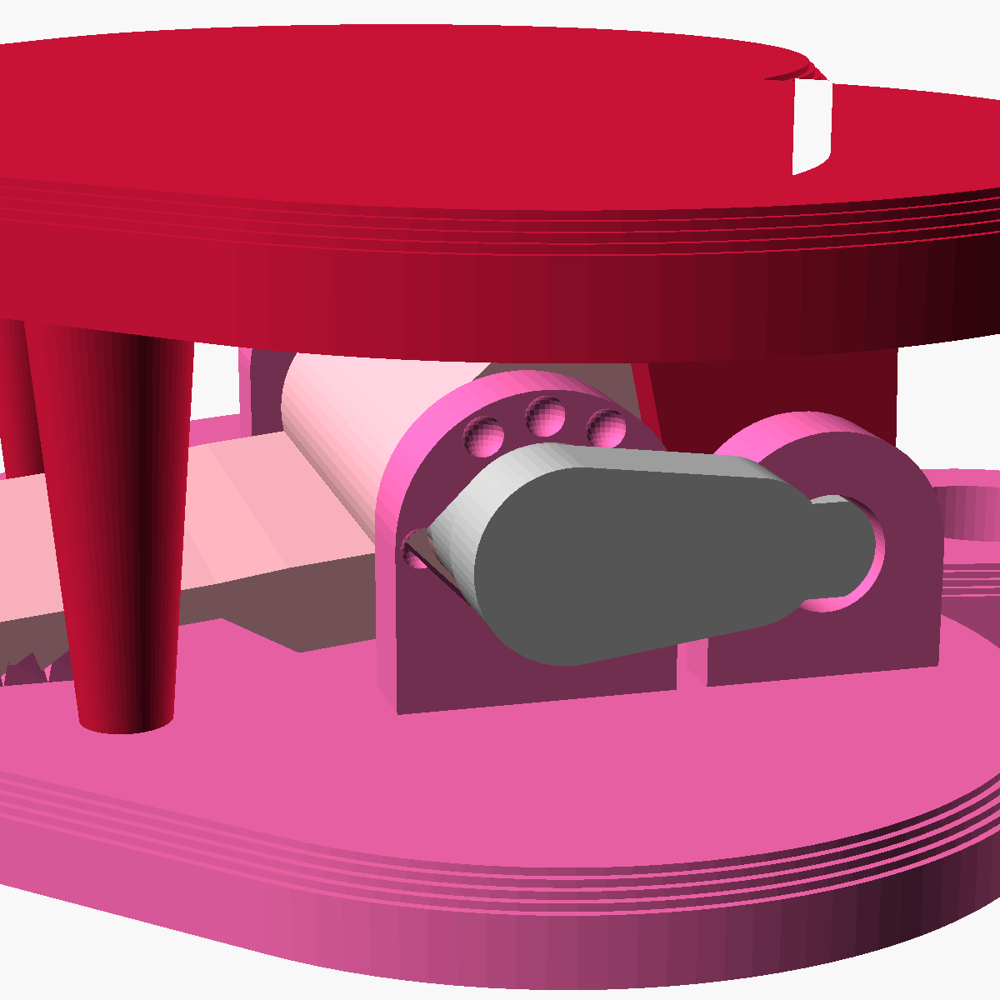

# Heart suspender clip (heart pacifier-clip style, hinge hidden, thickness dial)

From the front it's just a heart with a keychain ring at the top. The hinge, jaw, teeth and dial all sit behind the heart.
Hang it from your bag by the ring. The jaw mouth opens downward between the front heart and the heart-shaped back plate, and the flowstar's canvas trim clips in there and hangs below.

  

## How it works
- **Body:** a heart-shaped back plate with barbed teeth, two pairs of hinge knuckles and the keychain ring.
- **Front jaw:** pivots on the dial pin. Below the pin it's the gripping blade; above the pin it has a short tail.
- **Front heart:** the locking lever, on pin A behind the jaw's tail. Its cam pushes the tail forward, which swings the blade back onto the teeth.
  Lift the heart's point out and up to release the jaw, push the trim up into the mouth, then fold the heart flat.
  The cam rolls past dead-center and locks; a pull on the trim pushes the heart further closed.

## Thickness dial (one jaw, nothing to swap)
The lower hinge pin is a **dial pin** with an off-center middle. A small lever on its right-hand end, hidden between the two hearts, clicks into 5 positions.
Each click moves the jaw's pivot, which shifts the gripping edge about 1.15 mm. Set it with the heart open.

| Dial position | Lever points | Grips |
|---|---|---|
| 1 | up | 0 – 0.6 mm (thin fabric) |
| 2 | | 0.6 – 1.7 mm (single canvas layer, hemmed edge) |
| 3 | forward | 1.7 – 2.9 mm |
| 4 | | 2.9 – 4.0 mm (folded canvas) |
| 5 | down | 4.0 – 5.2 mm (folded canvas over a seam) |

Within each position, the jaw blade bends slightly, like the steel in a metal clip, so the heart always snaps fully flat.
With the heart open, the mouth is always at least 1 mm wider than the thickest trim for that position.

## Pulling and tugging
- The teeth are one-way barbs on both jaws: the trim slides in easily, and a pull digs them in. Canvas weave grips these very well.
- A pull can't flip the heart open (the cam is past center) or turn the dial (it's locked by the closed jaw).
- **Estimate, not tested:** about 6–16 N of clamping and well over 30 kg of strength in the ring, pins and jaw. Give it a few firm tugs before trusting it.

## Parts (`stl/`)
| File | Print orientation |
|---|---|
| `heart_clip_all_parts.stl` | everything laid out, 122 × 81 mm |
| `body.stl` | back flat on bed |
| `heart.stl` | front face down |
| `jaw.stl` | standing on edge (as exported) |
| `dial.stl` | standing up, lever on the bed (as exported). Use a brim |
| `cap.stl` | flat |
| `pin.stl` | lying flat |

No supports are needed. **Print the jaw and dial in PETG** because the jaw blade has to spring. The body and heart can be PLA. Use 0.2 mm layers, 4 walls and 40%+ infill.
The clip is 52 mm wide, about 64 mm tall with the ring, and about 18 mm thick.

## Assembly
1. Put the jaw between the lower knuckles, blade pointing down.
2. Slide the dial pin in from the **right** side (the big hole), lever outside, through the jaw and out of the small hole on the left.
   It only goes through the jaw with the lever pointing forward.
3. Press the cap onto the pin's left end with a drop of CA glue. Glue the cap to the pin only, not to the body, so the dial can still turn.
4. Put the heart's hinge between the upper knuckles, behind the jaw's tail, and push pin A through. Add a drop of glue on pin A's ends.

## Customising (`heart_suspender_clip.scad`)
`PART` = `assembly` | `open` | `body` | `heart` | `jaw` | `dial` | `cap` | `pin` | `plate`, and `DIAL` = 0–4 for previews.
Useful parameters are `ecc` (dial range), `dial_ang` (click positions), `preload`, `blade_t` (grip stiffness), `heart_w` and `ring_hole`.
