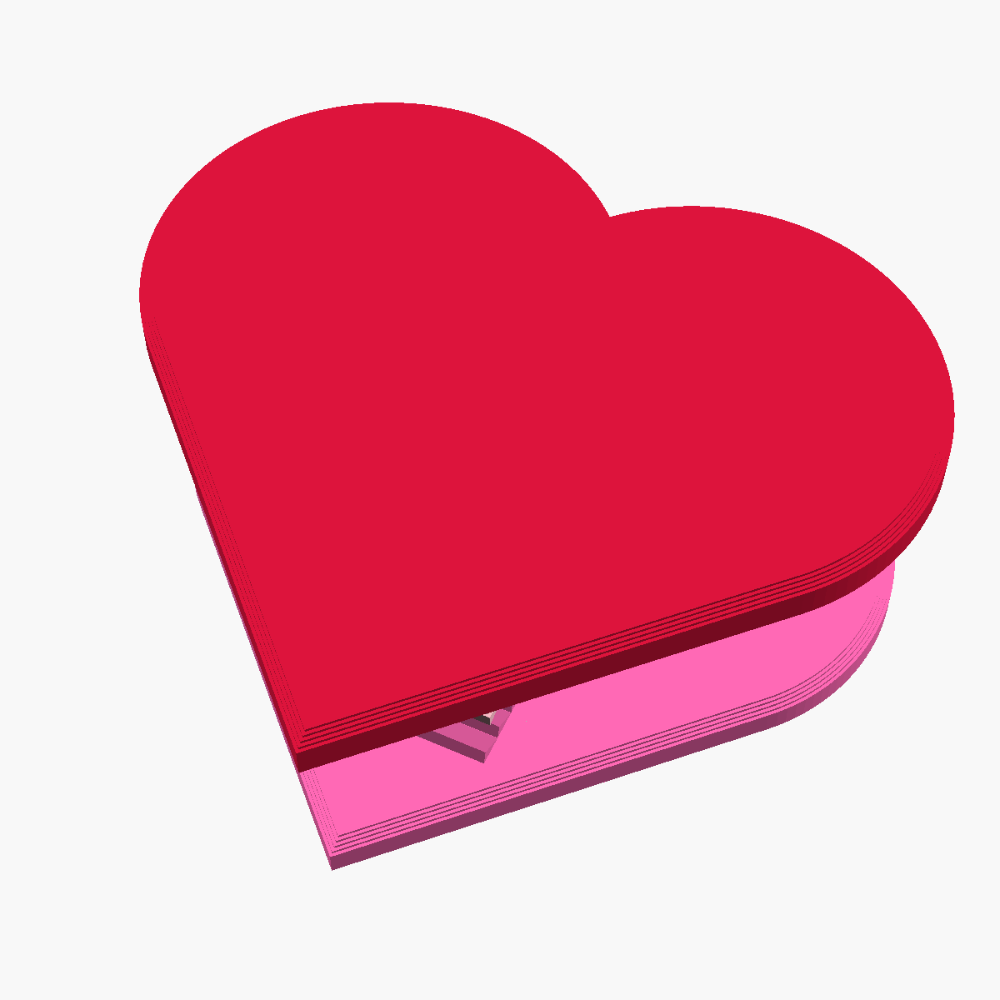
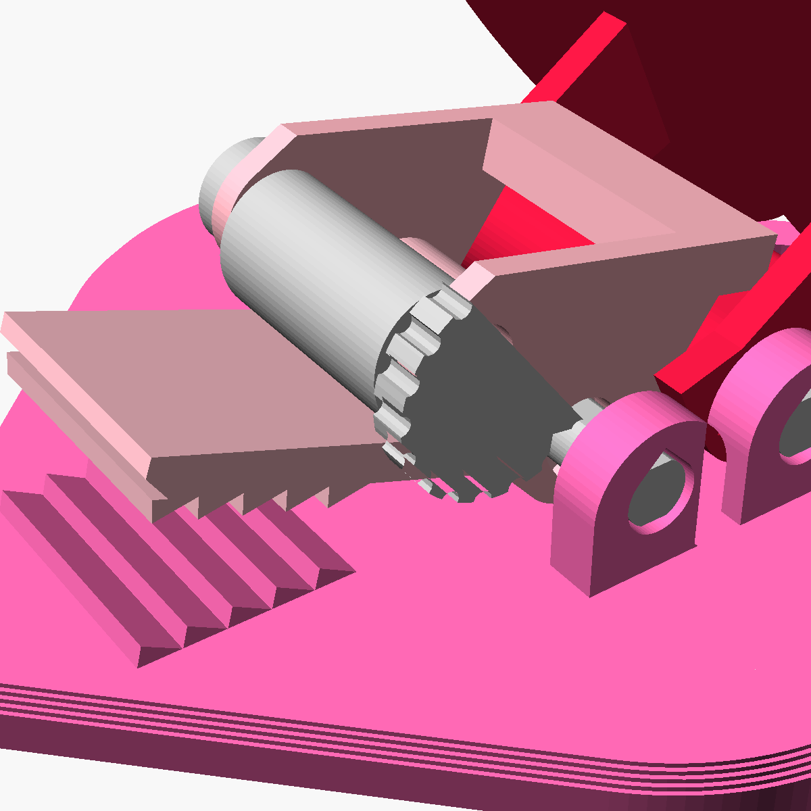

# Heart clip

A heart-shaped, suspender-style locking clip for hanging a flowstar from a bag. From the front it's just a heart with a keychain ring; the hinge, jaw and dial are hidden behind it.

  

## Using it
1. **Ring:** put a keychain ring or lobster clasp through the ring at the top and onto your bag.
2. **Open:** lift the heart's point out and up. The jaw opens downward, between the two hearts.
3. **Insert:** push the flowstar's canvas trim up into the jaw. It slides in over the barbs.
4. **Close:** fold the heart flat. It clicks shut and locks.

**Thickness wheel (set once for your trim):** with the heart open, there's a small knurled wheel inside on the right. Roll its front edge **down for thicker** trim and **up for thinner** trim.
It covers about **0.6 mm** (single canvas) to **5 mm** (trim folded in half).
If the heart is hard to click shut, roll it a little toward thicker. If the trim slips, roll it toward thinner. The wheel holds its position by itself.
The wheel only moves the gripping blade. The heart opens and locks exactly the same at every setting.

## Strength and tugging
- **Grip:** both jaws have big one-way barbs that interlock and press 0.4–0.6 mm into the trim when closed, at every wheel setting. That forces canvas into a zigzag that grips far harder than a flat squeeze, and pulling digs the barbs in further.
- **Lock:** the heart's cam locks past dead-center. A pull on the flowstar pushes the heart further closed, so tugging can't open it. The wheel is self-locking, so tugging can't turn it either.
- **Easy to use:** opening takes a light lift on the heart's point. Closing is a firm press, and the long heart gives a lot of leverage over the cam.
- **Parts outlast the grip:** the pins, posts, arm and ring are all much stronger than the grip, so a hard yank would drag the trim out of the teeth before anything breaks. For the most strength, use 3 mm steel pins (cut nails or dowel pins) instead of printed ones.
- **Rough estimate, not tested:** about 3–7 kg of steady pull before canvas slides. Give it a few firm tugs on the real trim before trusting it.

## What was checked in the 3D model
- Hangs ring-up with the jaw opening downward, and from the front only the heart and ring show.
- At 0.6, 1.5, 2.5, 3.5, 4.5 and 5.0 mm:
  - The heart's motion and lock are identical.
  - Nothing collides.
  - The barbs press 0.4–0.6 mm into the trim when closed.
  - The open mouth is at least 2 mm wider than the trim.
- The heart opens to about 65° and rests on hidden stops about 2° past flat.
- The thumbwheel turns a full 360° without touching anything.
- Every part is held sideways on its pin (0.4 mm or less of play): the jaw arm by the spacer rings, the heart by its hinge posts.

## Printing on a Creality Ender 3 V3 SE with PETG
The model is tuned for this printer and filament:
- **Holes:** a little oversize, because the V3 SE prints holes slightly small and PETG oozes.
- **Side gaps:** 0.3 mm where the first-layer squish would otherwise bind parts.
- **Horizontal holes:** teardrop-shaped with the tip up, so they print without support.

### 1. Print the fit test first (`fit_test.stl`, about 15 min)
- **Pin holes:** 6 holes, marked with 1–6 notches.
  - The test pin should push into hole **3** with firm finger pressure (the hinge posts) and spin freely in hole **5** (the moving parts).
  - If not, change `pin_clr_wall` / `pin_clr_mov` in `heart_suspender_clip.scad` to the clearance of the hole that fit, then re-export.
  - Hole clearances: 1 = 0.10, 2 = 0.15, 3 = 0.20, 4 = 0.25, 5 = 0.30, 6 = 0.35 mm.
- **D-holes:** 3 holes. The short D-shaft piece should slide into D-hole **2** without wobble.
  - If not, change `bore_clr` (D-hole 1 = 0.10, 2 = 0.20, 3 = 0.30 mm).

### 2. Slicer settings (Creality Print, Cura or Orca: Ender-3 V3 SE profile, Generic PETG)
| Setting | Value |
|---|---|
| Nozzle / layer height | 0.4 mm / 0.2 mm |
| Nozzle / bed temperature | 240 °C (230–245) / 75 °C |
| Bed surface | stock sheet **with a thin layer of glue stick** (PETG can bond too hard to bare PEI) |
| First layer | 25–30 mm/s. Set Z-offset about 0.03 mm higher than for PLA |
| Elephant foot compensation | 0.15 mm (if your slicer has it) |
| Speeds | outer wall 50, inner walls 80, infill 100 mm/s. **Not the 250 mm/s preset**: PETG layers bond poorly that fast |
| Cooling fan | 30–40 % (100 % for bridges) |
| Retraction | 0.8 mm at 40 mm/s, wipe on, z-hop 0.2 mm |
| Walls / top & bottom | 4 / 5 layers |
| Infill | 40 % gyroid. **100 %** for the pins, dial, cam, blade and spacer rings |
| Supports / brim | none / optional 3 mm brim on the blade |

**Enclosure:** PETG doesn't need it. Keep the door cracked so the chamber stays under about 35 °C, otherwise PETG can soften in the extruder and jam.

### 3. Print the clip
`heart_clip_all_parts.stl` (152 × 89 mm) fits the 220 × 220 bed and takes about 4–5 hours. Every part is already in its print orientation.

| Part | Qty | Notes |
|---|---|---|
| `body.stl` | 1 | heart back plate, ring, hinge posts, teeth |
| `heart.stl` | 1 | the locking front heart |
| `arm.stl` | 1 | jaw arm |
| `blade.stl` | 1 | gripping blade |
| `cam.stl` | 1 | spiral cam |
| `dial.stl` | 1 | thumbwheel + D-shaft |
| `cap.stl` | 1 | holds the dial in |
| `washer.stl` | 2 | spacer rings for the lower pin |
| `pin.stl` | 2 | or 3 mm steel pins, 24 mm long |

After printing, clear any PETG strings from the hinge holes with a 3 mm drill bit turned by hand.

## Assembly
1. **Lower pin:**
   - Put the blade (teeth facing back) between the arm's two side plates.
   - Set them between the lower hinge posts with a spacer ring on each side, between the arm and each post.
   - Push a pin through.
2. **Dial:**
   - Put the cam between the arm's side plates, in front of the blade.
   - Slide the dial in from the right, wheel outside, through the arm and the cam's D-hole.
   - Glue the cap onto the shaft's left end. Glue only the cap to the shaft, so the wheel can still turn.
3. **Upper pin:** put the heart's hinge between the upper hinge posts, behind the top of the arm, and push the second pin through.
4. **Glue:** add a drop of CA glue where each pin end sits in the hinge posts, so the pins can't walk out.

## Editing
Everything is generated from `heart_suspender_clip.scad` (OpenSCAD). Set `PART` to `assembly`, `open`, `plate`, `fit_test` or a single part name to preview or export it.
