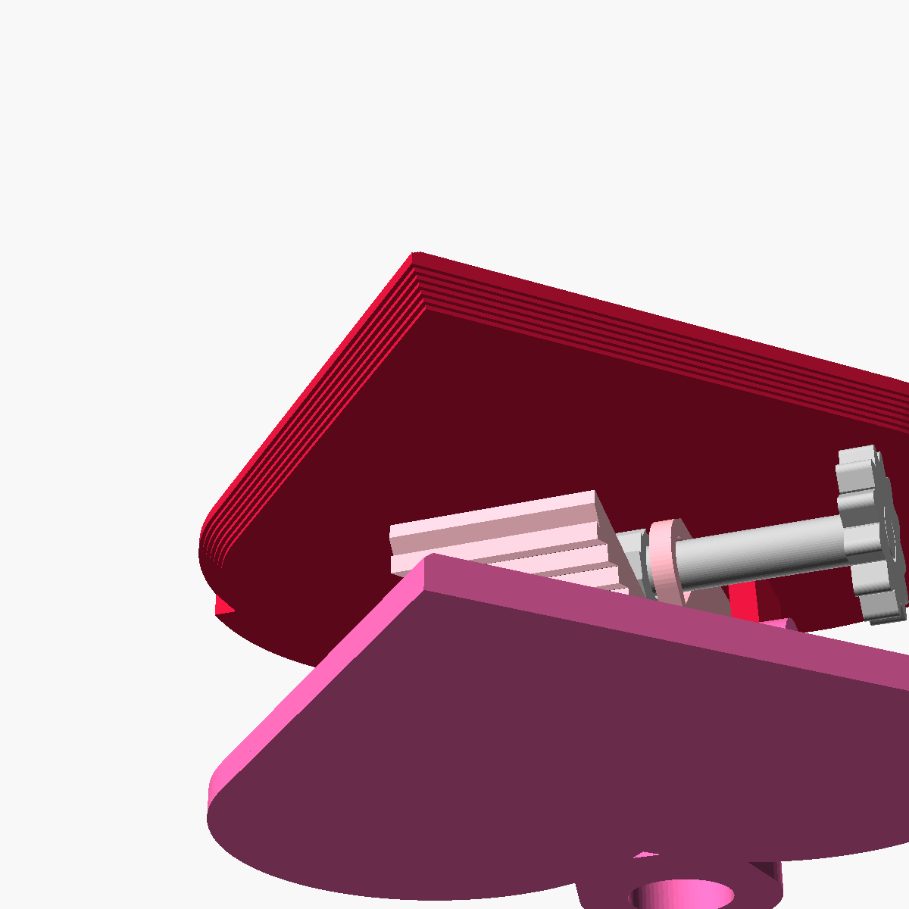

# Heart clip

A heart-shaped, suspender-style locking clip for hanging a flowstar from a bag. From the front it's just a heart with a keychain ring; the hinge, jaw and dial are hidden behind it.

  

## Using it
Designed so it works with long nails, shaky hands, or after a few drinks: big simple motions, nothing fiddly, and it can't be left half-locked.

1. **Ring:** put a keychain ring or lobster clasp through the ring at the top and onto your bag.
2. **Open, either way:**
   - **Press the top of the heart backward** with a thumb pad. The heart pivots like a seesaw and pops open. No nails needed.
   - Or **lift the bottom of the heart.** Its back edge is bevelled, so a fingertip or nail catches under it easily.
3. **Insert:** push the flowstar's canvas trim up into the jaw between the two hearts. It slides in over the barbs.
4. **Close:** press anywhere on the heart until it clicks flat. If it isn't fully clicked, the squeezed trim pushes it back open, so you can see straight away that it isn't locked.
5. **Set the grip once (on the real trim):** with the clip closed on the trim, flick the toothed wheel at the **right-hand edge**, between the two hearts, one tooth at a time.
   - Each tooth is one click, 0.5 mm. A long nail flicks the teeth easily, and so does a fingertip.
   - **Up** tightens, **down** loosens. Tighten until the trim won't pull out.
   - After that, leave it. Daily use is just open, insert, close.

 

**How the wheel works:** it turns a cam with 10 flat steps covering trim from about 0.3 to 5 mm (single canvas to folded in half).
- **It can't creep:** whichever flat is in use presses square-on against the blade, so pulling on the trim gives it no turning force.
- **It doesn't touch the lock:** it only moves the gripping blade. The heart opens, closes and locks the same way at every setting.
- **Wrap-around:** past the tightest click it wraps back round to the loosest.

## Strength and tugging
- **Grip:** both jaws have big one-way barbs that interlock and press 0.4–1.0 mm into the trim when closed (more on thick folded trim, which squashes more). That forces canvas into a zigzag that grips far harder than a flat squeeze, and pulling digs the barbs in further.
- **Lock:** the heart's cam locks past dead-center, so a pull on the flowstar pushes the heart further closed. The stepped cam means a pull can't turn the wheel either.
- **Easy to use:** lifting the bottom edge takes a light pull. Pressing the top to pop it open takes a firm thumb press, about 1 kg (a rough figure that depends on how tight the wheel is set). Closing is a firm press, and the long heart gives plenty of leverage.
- **Parts outlast the grip:** the pins, hinge posts, arm and ring are much stronger than the grip, so a hard yank would drag the trim out of the teeth before anything breaks. For the most strength, use 3 mm steel pins (cut nails or dowel pins).
- **Not tested:** this is a model, not a tested part. Because you set the grip on your own trim with the wheel, its holding power no longer depends on my guess about how much canvas squashes. Still, give it a few firm tugs before trusting it.

## What was checked in the 3D model
- Hangs ring-up with the jaw opening downward, and from the front only the heart and ring show.
- At all 10 wheel steps:
  - The heart's motion and lock are identical.
  - Nothing collides.
  - The closed barbs press 0.4–1.0 mm into the trim.
  - The open mouth is at least 1.5 mm wider than the trim.
- The front is a plain heart and ring, with no pull tab. The opening grip (bevelled back edge) and the wheel are hidden.
- The heart opens to about 65° and rests on hidden stops about 2° past flat.
- The cam, shaft and wheel turn a full 360° without touching anything.
- At every step the flat in use faces the blade square-on, so there's no turning force from a pull.
- Every part is held sideways on its pin (0.4 mm or less of play).

## Printing on a Creality Ender 3 V3 SE with PETG
The model is tuned for this printer and filament:
- **Holes:** a little oversize, because the V3 SE prints holes slightly small and PETG oozes.
- **Side gaps:** 0.3 mm where the first-layer squish would otherwise bind parts.
- **Horizontal holes:** teardrop-shaped with the tip up, so they print without support.

### 1. Print the fit test first (`fit_test.stl`, about 15 min)
- **Pin holes:** 6 holes, marked with 1–6 notches.
  - The test pin should push into hole **3** with firm finger pressure (the hinge posts) and spin freely in hole **5** (the moving parts).
  - If not, change `pin_clr_wall` / `pin_clr_mov` in `heart_suspender_clip.scad` to the clearance of the hole that fit, then re-export.
  - Hole clearances: 1 = 0.10, 2 = 0.15, 3 = 0.20, 4 = 0.25, 5 = 0.30, 6 = 0.35 mm.
- **D-holes:** 3 holes. The short D-shaft piece should slide into D-hole **2** without wobble.
  - If not, change `bore_clr` (D-hole 1 = 0.10, 2 = 0.20, 3 = 0.30 mm).

### 2. Slicer settings (Creality Print, Cura or Orca: Ender-3 V3 SE profile, Generic PETG)
| Setting | Value |
|---|---|
| Nozzle / layer height | 0.4 mm / 0.2 mm |
| Nozzle / bed temperature | 240 °C (230–245) / 75 °C |
| Bed surface | stock sheet **with a thin layer of glue stick** (PETG can bond too hard to bare PEI) |
| First layer | 25–30 mm/s. Set Z-offset about 0.03 mm higher than for PLA |
| Elephant foot compensation | 0.15 mm (if your slicer has it) |
| Speeds | outer wall 50, inner walls 80, infill 100 mm/s. **Not the 250 mm/s preset**: PETG layers bond poorly that fast |
| Cooling fan | 30–40 % (100 % for bridges) |
| Retraction | 0.8 mm at 40 mm/s, wipe on, z-hop 0.2 mm |
| Walls / top & bottom | 4 / 5 layers |
| Infill | 40 % gyroid. **100 %** for the pins, dial shaft, wheel, cam, blade and spacer rings |
| Supports / brim | none / optional 3 mm brim on the blade |

**Enclosure:** PETG doesn't need it. Keep the door cracked so the chamber stays under about 35 °C, otherwise PETG can soften in the extruder and jam.

### 3. Print the clip
`heart_clip_all_parts.stl` (163 × 89 mm) fits the 220 × 220 bed and takes about 4–5 hours. Every part is already in its print orientation.

| Part | Qty | Notes |
|---|---|---|
| `body.stl` | 1 | heart back plate, ring, hinge posts, teeth |
| `heart.stl` | 1 | the locking front heart |
| `arm.stl` | 1 | jaw arm |
| `blade.stl` | 1 | gripping blade |
| `cam.stl` | 1 | spiral cam |
| `dial.stl` | 1 | D-shaft for the cam and wheel |
| `wheel.stl` | 1 | toothed wheel (10 clicks) |
| `cap.stl` | 1 | holds the dial in |
| `washer.stl` | 2 | spacer rings for the lower pin |
| `pin.stl` | 2 | or 3 mm steel pins, 24 mm long |

After printing, clear any PETG strings from the hinge holes with a 3 mm drill bit turned by hand.

## Assembly
1. **Lower pin:**
   - Put the blade (teeth facing back) between the arm's two side plates.
   - Set them between the lower hinge posts with a spacer ring on each side, between the arm and each post.
   - Push a pin through.
2. **Dial:**
   - Put the cam between the arm's side plates, in front of the blade.
   - Slide the D-shaft in from the right, through the arm and the cam's D-hole.
   - Glue the cap onto its left end and the wheel onto its right end. Glue only to the shaft, so it all still turns.
3. **Upper pin:** put the heart's hinge between the upper hinge posts, behind the top of the arm, and push the second pin through.
4. **Glue:** add a drop of CA glue where each pin end sits in the hinge posts, so the pins can't walk out.

## Editing
Everything is generated from `heart_suspender_clip.scad` (OpenSCAD). Set `PART` to `assembly`, `open`, `plate`, `fit_test` or a single part name to preview or export it.
