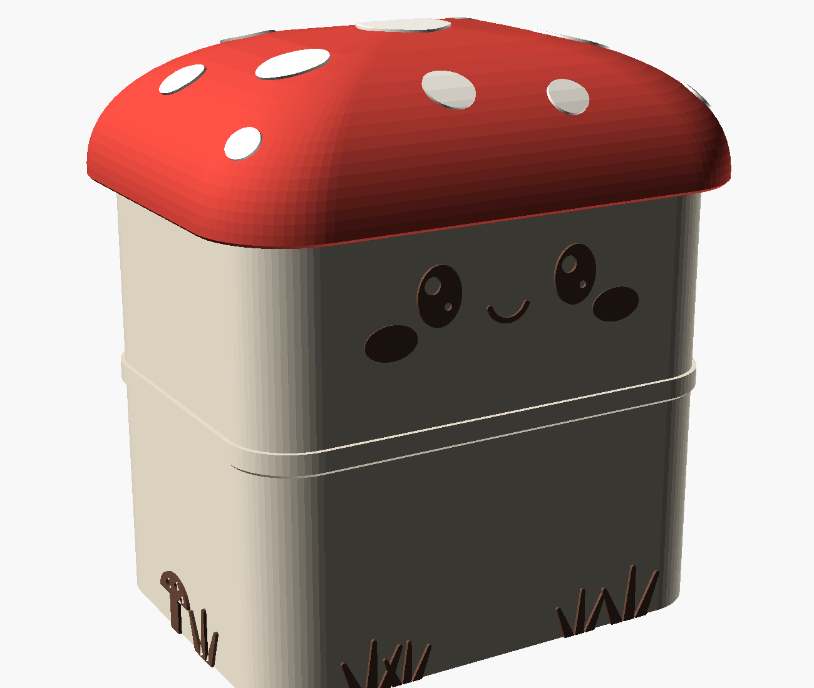
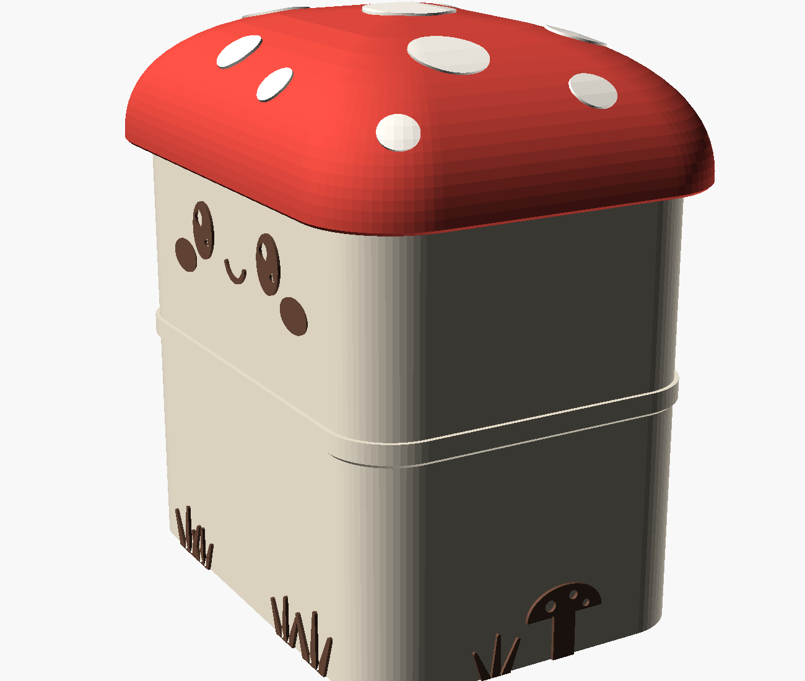

# Toadstool Sewing Box

A large sewing box shaped like a toadstool mushroom. The cream stem is the box and has a little face. The red cap with white spots is the lid. Inside are lift-out trays with snap-on lids.



| | |
|---|---|
|  |  |

## Size
- **Stem (box):** 330 W × 240 D × 290 H mm (13 × 9.5 × 11.4 in).
- **Cap:** 366 × 276 mm. With the cap on, the box is about 385 mm tall.
- **Inside:** 322 × 232 mm, about 286 mm deep.
- **Trays:** there are two stacks, left and right. Each stack is a 60 mm deep tray with a 45 mm shallow tray on top. The deep tray hangs from a ledge on its end lugs, and the shallow tray sits on the deep tray's lid.
- **Bin:** a clear 174 mm deep space under the trays for fabric, scissors and projects in progress.

## Parts (`stl/`) — bed needed: 250 × 250 mm
| File | Qty | Notes |
|---|---|---|
| body_lower_left / _right | 1 each | Print upright, no supports |
| body_upper_left / _right | 1 each | Print upright. The ledge has a built-in 45° gusset |
| cap_front_left / _right, cap_back_left / _right | 1 each | Print right side up on the flat underside, no supports. The cap is a solid dome, so 10–15 % infill keeps it light |
| tray_deep_grid | 1 | 3 × 4 grid (bobbins, buttons) |
| tray_deep_split | 1 | 2 large bays |
| tray_shallow_grid | 1 | 2 × 3 grid |
| tray_shallow_long | 1 | 3 long slots (needles, seam ripper, chalk) |
| tray_lid | 4 | Prints top-down. A small toadstool is pressed into the top |

Suggested settings: PLA or PETG, 0.2 mm layers, 3 walls, 15 % infill.

**Colours:** print the stem in cream and the cap in red. The face, grass and side mushrooms are raised 0.8–2.2 mm, so use a colour change at those heights or paint them. The cap spots are raised 1.6 mm; a white paint pen makes them easy.

## Assembly
1. **Pins:** cut 1.75 mm filament into 11 mm pieces and use them as dowels in the 2 mm holes on every split face.
2. **Stem halves:** glue the left and right halves together with CA glue, or with plastic weld for PLA. Do this for the lower and upper tiers.
3. **Tiers:** the lower tier has a sleeve that the upper tier slides over. Glue it; the seam hides under the mushroom's ring.
4. **Cap:** glue the four quarters together. A rim on top of the stem keys into a groove under the cap, so the cap sits square. Lift it by the overhanging edge.
5. **Tray lids:** press each lid onto its tray until it clicks. To open, push up on the small tab above the lug.

## Customising
Everything is set by parameters in `toadstool_sewing_box.scad`: the stem size, how far the cap overhangs and how tall it is (`CAP_OVER`, `CAP_H`, `CAP_P`), where the spots go (`SPOTS`), tray heights, divider grids, and snap tightness. Export a part with:
```
openscad -D 'part="tray_lid"' -o tray_lid.stl toadstool_sewing_box.scad
```
- **Snap too tight or too loose:** change `CATCH`. The default 0.25 gives 0.35 mm of interference; raise it to loosen the snap.
- **220 mm bed (e.g. Ender 3):** set `D = 215` and `TD = 184`.
- **12 in front-to-back:** set `D = 305` and `TD = 272`. The stem halves then need a 310 mm bed.
