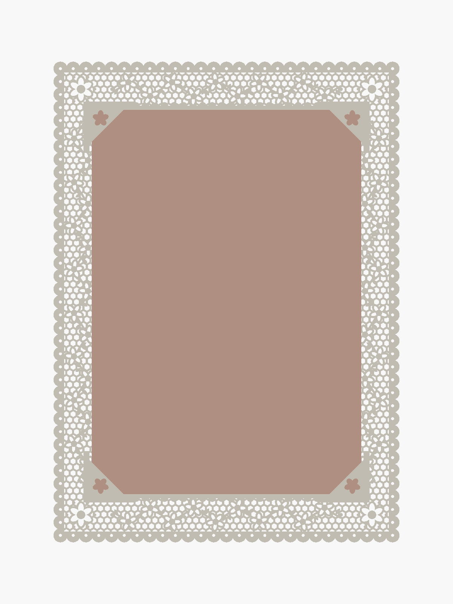
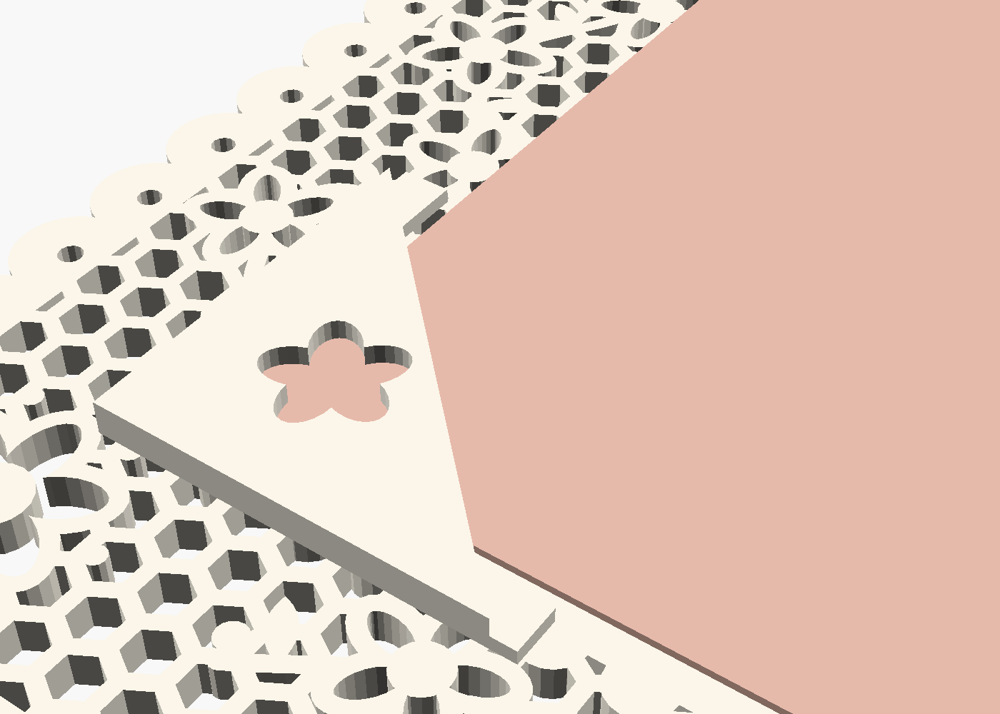

# Lace wedding invitation: Meher & Marlon, Valley of Fire, May 20, 2027

A flat, 3D-printed lace invitation sized to slip into a standard **A6 envelope (4¾ × 6½ in)**.
- **Card:** 4½ × 6¼ in (114 × 159 mm) and 2.8 mm thick at the pockets.
- **Front:** fine tulle-net lace with a cut-work floral vine, a scalloped picot edge, and an arched center panel with gold lettering.
- **Back:** four corner pockets hold a **3½ × 5 in** paper details card.

| Front | Back with the details card | Pocket |
|---|---|---|
|  |  |  |

## Files
- `stl/invitation_body.stl`: the card (ivory / white)
- `stl/invitation_inlay_gold.stl`: optional 0.6 mm inlay that fills the engraved lettering (gold)
- `invitation.scad`: editable source (wording, card size, insert size, lace)
- `tools/build.sh`: rebuilds the STLs (OpenSCAD plus `pip install manifold3d trimesh`)
- `tools/previews.sh`: rebuilds `renders/front.png` (Node and Playwright)

## Printing
- Print the card **face-down**, exactly as the STL is oriented. No supports are needed.
- Use a 0.4 mm nozzle, 0.2 mm layers, 100% infill, and Arachne / variable line width. The lace threads are about 0.63 mm wide.
- **Two colours (AMS / MMU):** load both STLs as one object, with ivory for the body and gold for the inlay.
- **One colour:** print only the body. Optionally rub gold wax (for example Rub 'n Buff) into the engraving.
- A smooth plate gives a satin face. A textured plate gives a sparkle face.

## Envelope
The card fits an A6 envelope with about ⅛ in to spare on each side. Because the card is rigid, US mail charges a
non-machinable surcharge, so ask for hand-canceling or mail the envelopes inside an outer box.
For a different envelope, change `W`, `H`, `insert_w` and `insert_h` in `invitation.scad`. For example,
an A7 envelope (5¼ × 7¼ in) takes a 5 × 7 in card with a 4 × 6 in insert.

Fonts: Great Vibes and Cinzel (SIL Open Font License, Google Fonts).
