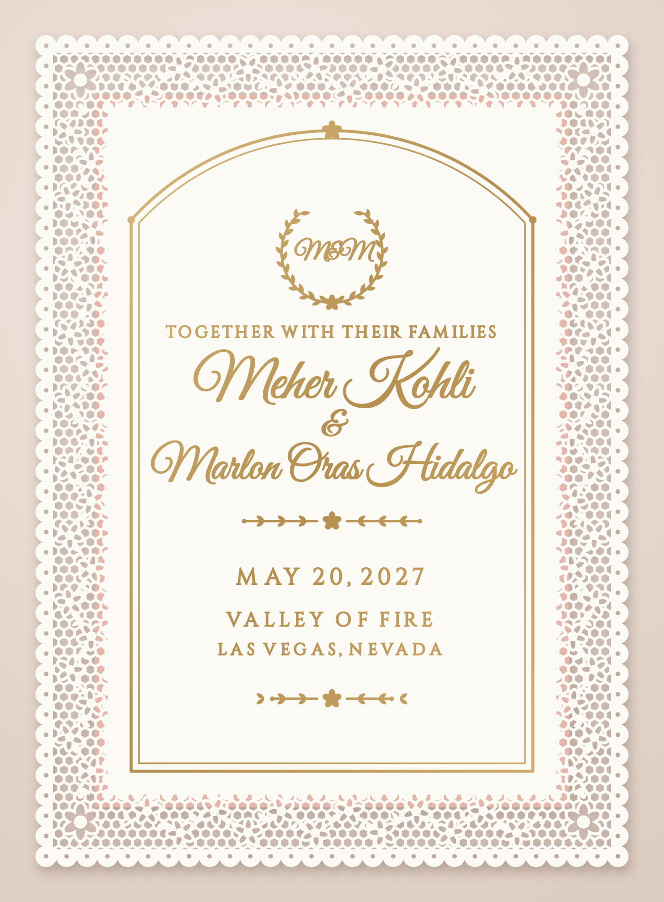

# Lace wedding invitation: Meher & Marlon, Valley of Fire, May 20, 2027

A 3D-printed 5 × 7 in lace invitation. The front has a fine tulle-net lace border with a
cut-work floral vine, scalloped picot edges, and an arched center panel (a nod to the
Valley of Fire arches) with engraved lettering and an M & M monogram wreath.
The back has four corner pockets that hold a **4 × 6 in paper details card**.

| Front | Back with the details card | Pocket |
|---|---|---|
|  |  |  |

## Files
- `stl/invitation_body.stl`: the card (print in ivory / white)
- `stl/invitation_inlay_gold.stl`: optional 0.6 mm inlay that fills the engraving (gold)
- `invitation.scad`: editable source (wording, sizes, lace density)
- `tools/build.sh`: rebuilds both STLs (OpenSCAD plus `pip install manifold3d trimesh`)

## How to print
- **Print face-down.** The STL is already oriented that way: the front lies on the bed and the pockets point up. No supports are needed (the pocket flaps bridge about 9 mm).
- A smooth PEI or glass plate gives a satin front. A textured plate gives a sparkle finish.
- Use a 0.4 mm nozzle, 0.2 mm layers, 100% infill, and Arachne / variable line width (the default in PrusaSlicer, Bambu Studio and Orca). The lace threads are about 0.63 mm wide.
- **Two colours (AMS / MMU):** load both STLs as one multi-part object, with ivory for the body and gold for the inlay. The lettering comes out flush and in colour.
- **One colour:** print only the body. The lettering comes out engraved. Optionally rub gold wax (for example Rub 'n Buff) into the engraving and wipe the surface clean.
- About 1.6 mm thick (3.2 mm at the pockets), 127 × 178 mm, so it fits a 180 mm or larger bed.

## Details card
Print the details card on 4 × 6 in cardstock up to about 0.45 mm thick. Bow it slightly and
slip its corners under the four flaps. A blush or terracotta card shows through the inner edge of
the lace like a lining, and through the flower cut-outs on the flaps.

## Editing
Change the wording at the top of `invitation.scad` (`name_1`, `name_2`, `line_*`). To change
the size of the details card, edit `insert_w` / `insert_h`. Then run `tools/build.sh`.
Fonts: Great Vibes and Cinzel (SIL Open Font License, Google Fonts).
