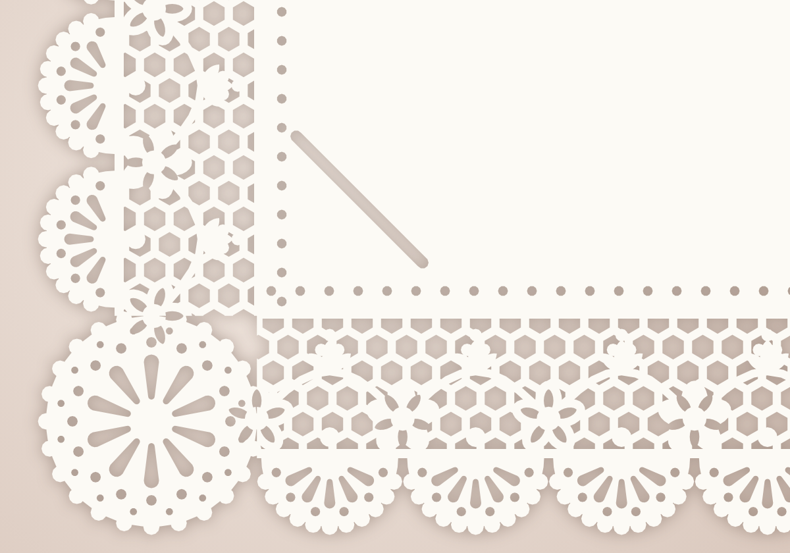

# Lace envelope-fold invitation: Meher & Marlon, Valley of Fire, May 20, 2027

One 3D-printed lace sheet that **folds into its own envelope** and **opens into a full-page invitation**.

- **Folded:** 6½ × 3½ in (165 × 90 mm), about the size of a #6¾ envelope, closed with a monogram wax seal.
- **Opened:** a 6½ × 9¾ in page (166 × 247 mm) with a Chantilly-style lace border on every outer edge. It has three panels:
  - **Top flap:** the pointed flap, with the lace running up both sides to a round tip where the seal sits.
  - **Middle panel:** six short lines of small, evenly spaced gold capitals with one script "&" and a gold hairline, surrounded by plenty of white space.
  - **Bottom panel:** four corner slits hold a **5 × 2½ in paper details card**.

| Closed | Opened | Lace close-up |
|---|---|---|
|  |  |  |

## The lace
The border is built the way real Chantilly-style lace is, working from the outer edge inward:
1. **Scallops:** each scallop holds an openwork fan, with tiny picot points around its rim.
2. **Net:** a fine net, about 0.63 mm threads, carries garland swags between open five-petal flowers, with a bud and leaves on each swag.
3. **Inner edge:** a solid line finished with a beaded row of tiny holes.

Large lace rosettes finish the two bottom corners.
Every printed strand is at least about 0.45 mm wide, so it prints with a 0.4 mm nozzle.

## Design notes
- **Lace is the art, type is quiet:** only two typefaces, Cinzel capitals and a Great Vibes "&".
- **Small type:** capitals are 2 to 3.3 mm tall.
- **Even letter spacing:** each letter is placed by its real width from the font (`fonts/cinzel_widths.scad`).

## Files
- `stl/envelope_invitation_body.stl`: the whole sheet (ivory / white), one piece
- `stl/envelope_invitation_inlay_gold.stl`: optional 0.6 mm gold inlay for the lettering
- `invitation.scad`: editable source (wording, panel sizes, card size)
- `tools/build.sh`: rebuilds the STLs. `tools/previews.sh` rebuilds the images. `tools/glyph_widths.py` regenerates the letter-width table.

## Printing
- **Bed:** the sheet is 166 × 247 mm, so it fits 250 × 250 mm and 256 × 256 mm beds. Print it as exported, **inside face down**. No supports are needed.
- **Material:** PETG is best for the two fold hinges. PLA works if you make the first folds slowly. Warming the hinge with a hair dryer helps.
- **Settings:** 0.4 mm nozzle, 0.2 mm layers (the hinges are the first two layers, 0.4 mm), 100% infill, Arachne / variable line width. Turn on **ironing** for the top surface, because that becomes the outside of the envelope.
- **Gold lettering:** with an AMS / MMU, load both STLs as one object and assign gold to the inlay. On a one-colour printer, skip the inlay and rub gold wax (for example Rub 'n Buff) into the lettering and over the raised seal.

## Folding
1. Tuck the corners of the paper details card into the four slits on the bottom panel.
2. Fold the **bottom panel up** over the middle panel.
3. Fold the **top flap down** over it. Hold it shut with a small removable glue dot under the seal.

Once closed, the tips of the details card show in the bottom corners of the envelope front.
It's a nice touch if the card is a colour (blush or terracotta).

## Mailing
It's rigid and a little under 4 mm thick when closed, so in the US it needs the non-machinable surcharge.
You can also put it inside a 7 × 4 in outer envelope or a padded mailer.

Fonts: Great Vibes and Cinzel (SIL Open Font License, Google Fonts).
