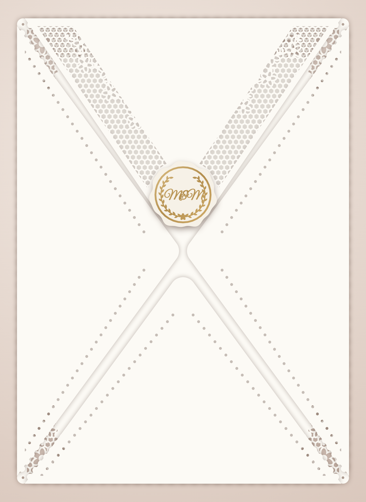
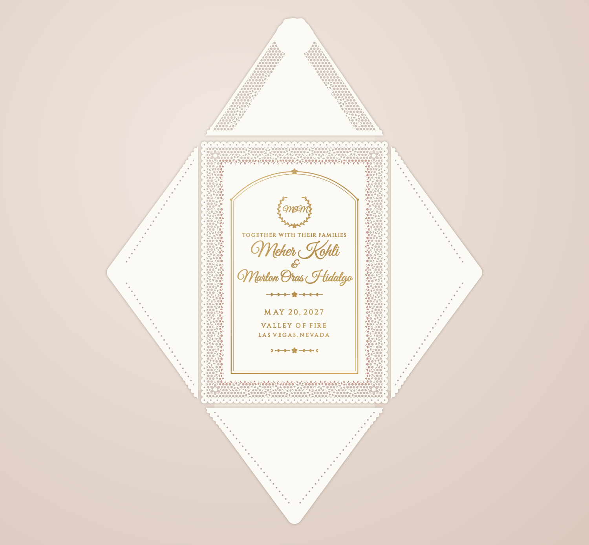
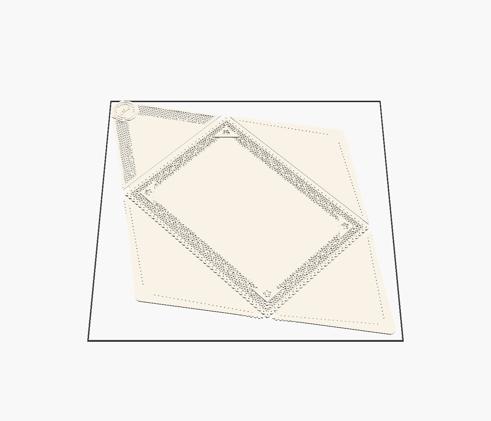

# Lace envelope invitation: Meher & Marlon, Valley of Fire, May 20, 2027

A 3D-printed lace invitation that folds into its own envelope. It prints flat as one piece.
Four flaps are joined to the 5 × 7 in invitation by thin living hinges and fold over the front.
The top flap has a lace-and-flower trim and ends in a monogram "wax seal".
Inside is the lace card with the arched panel and gold lettering. On the back, four corner pockets hold a
**4 × 6 in paper details card**.

| Closed | Open | Printed flat |
|---|---|---|
|  |  |  |

Also: `renders/front.png` (the card face) and `renders/pocket_closeup.png` (a pocket on the back).

## Files
- `stl/envelope_invitation_body.stl`: the whole envelope and card (ivory / white). It is already placed at 45° to fit the bed.
- `stl/envelope_invitation_inlay_gold.stl`: optional 0.6 mm gold inlay for the card lettering (same placement)
- `invitation.scad`: editable source (wording, sizes, flap depths, lace)
- `tools/build.sh`: rebuilds the STLs (OpenSCAD plus `pip install manifold3d trimesh`)
- `tools/previews.sh`: rebuilds the preview images (also needs Node and Playwright)

## Printing
- **Bed size:** the footprint is 248 × 248 mm, so it needs a **256 × 256 mm bed** (Bambu X1/P1/A1, Creality K1 Max, and similar). Import it as-is. It is already rotated to fit.
- **Orientation:** as exported. The invitation front and the flap insides lie on the bed. No supports are needed.
- **Material:** PETG gives the most forgiving hinges. Matte or silk PLA also works if you make the first folds slowly. If the hinges feel stiff, warm them briefly with a hair dryer.
- **Settings:** 0.4 mm nozzle, 0.2 mm layers (the hinges are the first two layers, 0.4 mm), 100% infill, Arachne / variable line width. Turn on **ironing for top surfaces**, because the outside of the closed envelope is the print's top face.
- **Gold lettering:** with an AMS / MMU, load both STLs as one object and assign gold to the inlay.
  On a one-colour printer, skip the inlay and rub gold wax (for example Rub 'n Buff) into the engraved lettering and over the seal's raised monogram.

## Folding it closed
1. Slip the details card into the corner pockets on the back.
2. Fold the **left and right** flaps in over the front.
3. Fold the **bottom** flap up.
4. Fold the **top** flap down. The seal lands just above the center. Hold it closed with a small removable glue dot under the seal, or tie a thin silk ribbon around the envelope.

The hinge gaps get wider in that order (2.0 / 2.8 / 4.0 mm) so that each flap clears the ones below it.

## Editing
Change the wording at the top of `invitation.scad`. The envelope settings are in the ENVELOPE section:
`side_h`, `bot_h`, `top_h` (flap depths), `g_*` (hinge gaps), `hinge_t`, and `seal_r`.
Fonts: Great Vibes and Cinzel (SIL Open Font License, Google Fonts).
